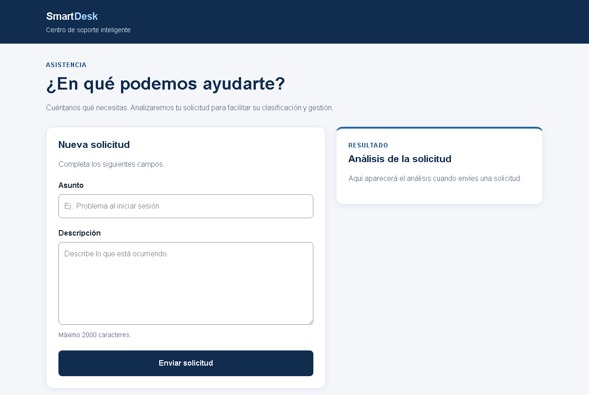

# SmartDesk

Centro de soporte que recibe solicitudes de usuarios, las registra en PostgreSQL y las clasifica automáticamente con IA (Google Gemini) mediante un workflow de n8n.



> **Estado del proyecto:** prototipo funcional y prueba de concepto. La instalación desde cero, las pruebas automatizadas y el flujo backend → n8n se han verificado en un entorno aislado, y la clasificación con Gemini real se ha comprobado manualmente desde la interfaz (detalles en [Verificación](#verificación)). **No está preparado para producción**: consulta [Limitaciones conocidas](#limitaciones-conocidas).

---

## Qué problema resuelve

En un equipo de soporte, clasificar cada solicitud a mano (qué tipo de problema es y con qué urgencia hay que atenderlo) consume tiempo y produce criterios inconsistentes. SmartDesk automatiza esa primera clasificación:

1. La persona usuaria describe su problema en un formulario web accesible.
2. El backend valida la solicitud, la guarda con estado `PENDING` y la envía a n8n.
3. n8n pide a Gemini que la clasifique y normaliza la respuesta.
4. El backend marca la solicitud como `SENT` y devuelve el análisis al formulario.

| Campo del análisis | Valores posibles | Se muestra como |
|---|---|---|
| `category` | `access`, `technical_error`, `query`, `other` | Acceso, Error técnico, Consulta, Otra |
| `priority` | `low`, `medium`, `high` | Baja, Media, Alta |
| `summary` | Resumen breve en español | Texto libre |

---

## Arquitectura

```
┌────────────────────┐   POST /support    ┌──────────────────────┐
│ Frontend accesible │ ─────────────────► │  API NestJS          │
│ HTML · CSS · JS    │ ◄───────────────── │  (backend/src)       │
│ (backend/public)   │   análisis JSON    └───┬──────────────┬───┘
└────────────────────┘                        │ Prisma 7     │ HTTP POST (timeout 30 s)
                                              ▼              ▼
                                   ┌────────────────┐  ┌──────────────────────────┐
                                   │  PostgreSQL    │  │ n8n · webhook            │
                                   │ SupportRequest │  │ "support-request"        │
                                   └────────────────┘  │  → Gemini (LLM chain)    │
                                                       │  → normalización (Code)  │
                                                       └──────────────────────────┘
```

- **Frontend** (`backend/public/`): HTML, CSS y JavaScript sin frameworks, servido por NestJS como contenido estático.
- **API NestJS** (`backend/src/`):
  - `POST /support`: recibe `subject` (máx. 120 caracteres) y `description` (máx. 2000). Un `ValidationPipe` global rechaza datos inválidos y campos no permitidos (400).
  - `GET /health`: comprueba que PostgreSQL responde y que el webhook de n8n está configurado. Devuelve 200 si todo está bien y 503 si falla algo. No invoca el webhook, para no ejecutar el workflow ni consumir la API de Gemini.
- **Persistencia** (`backend/prisma/`): Prisma 7 con el adaptador `@prisma/adapter-pg` y un modelo `SupportRequest` (`PENDING` → `SENT`).
- **Automatización** (`n8n/`): webhook → construcción del prompt → Gemini → nodo Code que normaliza el JSON y aplica valores por defecto (`other` / `low`) si el modelo devuelve algo no interpretable.
- **Gestión de errores:** si n8n falla, no responde o tarda más de 30 s, la solicitud queda en `PENDING`, se registra el error (sin el contenido de la solicitud) y la API responde 503 con un mensaje que el frontend muestra a la persona usuaria.

---

## Tecnologías

| Capa | Tecnología |
|---|---|
| Backend | NestJS 11, TypeScript 5.9 |
| Validación | class-validator, class-transformer |
| ORM / BD | Prisma 7.10 (`prisma-client` + `@prisma/adapter-pg`), PostgreSQL 18 |
| Integración HTTP | `@nestjs/axios` 12 |
| Configuración | `@nestjs/config` 12, archivos `.env` |
| Automatización | n8n 2.44.5 (Webhook, Set, Basic LLM Chain, Google Gemini Chat Model, Code) |
| IA | Google Gemini (`models/gemini-3.1-flash-lite`, temperatura 0.2) |
| Frontend | HTML, CSS y JavaScript sin frameworks |
| Entorno local | Docker Compose (PostgreSQL + n8n) |
| Calidad | Jest 30, Supertest, ESLint 9, Prettier 3 |

---

## Estructura del repositorio

```
smartdesk/
├── docker-compose.yml          # PostgreSQL + n8n para desarrollo local
├── .env.example                # Variables de Docker Compose
├── docs/                       # Capturas para la documentación
├── backend/
│   ├── src/
│   │   ├── main.ts             # Arranque
│   │   ├── app.setup.ts        # Validación global y contenido estático (compartido con e2e)
│   │   ├── app.module.ts
│   │   ├── health/             # GET /health
│   │   ├── prisma/             # PrismaService (adaptador pg)
│   │   └── support/            # POST /support: controlador, servicio, DTO y pruebas
│   ├── public/                 # Frontend accesible
│   ├── prisma/                 # schema.prisma y migraciones
│   ├── prisma7.config.ts       # Configuración de Prisma 7 (Prisma la detecta automáticamente)
│   ├── test/                   # Pruebas e2e
│   └── .env.example            # Variables del backend
└── n8n/
    ├── smartdesk-workflow.json          # Workflow saneado, listo para importar
    ├── crear-credencial-gemini.ps1      # Script auxiliar para la credencial de Gemini
    └── README.md
```

---

## Requisitos previos

| Requisito | Detalle |
|---|---|
| Node.js | `^20.19.0`, `^22.12.0` o `>=24` (declarado en `engines`, porque `@nestjs/axios` 12 es un paquete ESM). Verificado con Node 24.22.1 y npm 11.21.1. |
| PostgreSQL | Con Docker Compose (incluido) o con una instalación propia. Verificado con PostgreSQL 18.1. |
| n8n | Con Docker Compose (incluido) o con `npx n8n@2.44.5`. Verificado con n8n 2.44.5 ejecutado con Node. |
| Docker | Opcional. Necesario solo para `docker-compose.yml`. En Windows: Docker Desktop con WSL2. Verificado con Docker 29.9.2 y Compose v5.6.1. |
| Gemini | Una API key de Google Gemini, que se configura **dentro de n8n**, no en el backend. |

---

## Instalación desde cero

### 1. Servicios: PostgreSQL y n8n

**Opción A: Docker Compose (recomendada)**

```bash
cp .env.example .env            # PowerShell: Copy-Item .env.example .env
# Edita .env: cambia como mínimo POSTGRES_PASSWORD.
docker compose up -d
docker compose ps               # ambos servicios deben aparecer como "healthy"
```

- PostgreSQL queda en `127.0.0.1:${POSTGRES_PORT}` (5432 por defecto).
- n8n queda en `http://localhost:${N8N_PORT}` (5678 por defecto).

Si ya usas esos puertos, cambia `POSTGRES_PORT` o `N8N_PORT` en `.env`.

**Opción B: servicios propios.** Crea una base de datos vacía en tu PostgreSQL y arranca n8n con `npx n8n@2.44.5`.

### 2. Backend

```bash
cd backend
cp .env.example .env            # PowerShell: Copy-Item .env.example .env
```

Edita `backend/.env`:

| Variable | Uso | Valor con Docker Compose |
|---|---|---|
| `DATABASE_URL` | Conexión a PostgreSQL. La usan Prisma y `PrismaService`. Obligatoria: sin ella la API no arranca. | `postgresql://<POSTGRES_USER>:<POSTGRES_PASSWORD>@localhost:<POSTGRES_PORT>/<POSTGRES_DB>?schema=public` |
| `N8N_WEBHOOK_URL` | URL completa del webhook de producción. Sin ella, `POST /support` y `/health` responden 503. | `http://localhost:<N8N_PORT>/webhook/support-request` |
| `PORT` | Puerto HTTP del backend (opcional). | `3000` |

> El backend se ejecuta en tu máquina, no dentro de Docker, así que usa `localhost` y los puertos publicados por Compose. Dentro de un contenedor, `localhost` se referiría al propio contenedor.

```bash
npm ci                 # instala dependencias y genera el cliente Prisma (postinstall)
npm run db:migrate     # aplica las migraciones existentes (prisma migrate deploy)
```

### 3. n8n y Gemini

1. Abre n8n (`http://localhost:5678`) y crea la cuenta de propietario local.
2. Crea una credencial **Google Gemini (PaLM) API** con tu API key y llámala exactamente `Gemini - SmartDesk`.
3. Importa `n8n/smartdesk-workflow.json`. Si existe una credencial con ese nombre, n8n la asigna automáticamente al nodo del modelo.
4. Publica o activa el workflow.

Las instrucciones detalladas, incluida la importación por CLI, están en [`n8n/README.md`](n8n/README.md).

### 4. Ejecutar

```bash
npm run start:dev      # desarrollo con recarga automática
```

Abre `http://localhost:3000/` y comprueba el estado con `curl http://localhost:3000/health`.

Para producción local:

```bash
npm run build
npm run start:prod     # ejecuta dist/src/main.js
```

---

## Docker Compose

`docker-compose.yml` define un entorno de **desarrollo local**:

| Servicio | Imagen | Puerto (solo 127.0.0.1) | Volumen persistente | Healthcheck |
|---|---|---|---|---|
| `postgres` | `postgres:18.6-alpine` | `${POSTGRES_PORT:-5432}` | `postgres_data` | `pg_isready` |
| `n8n` | `n8nio/n8n:2.44.5` | `${N8N_PORT:-5678}` | `n8n_data` (SQLite, clave de cifrado y credenciales) | `GET /healthz` |

- Las contraseñas se leen de `.env` y no tienen valores por defecto: `docker compose` falla si falta `POSTGRES_PASSWORD`.
- No contiene claves de Gemini: la credencial se crea en la interfaz de n8n y se guarda cifrada en el volumen `n8n_data`.

| Acción | Comando | ¿Conserva los datos? |
|---|---|---|
| Iniciar | `docker compose up -d` | Sí |
| Ver estado | `docker compose ps` | Sí |
| Ver registros | `docker compose logs -f n8n` (o `postgres`) | Sí |
| Reiniciar un servicio | `docker compose restart n8n` | Sí |
| Detener (sin eliminar contenedores) | `docker compose stop` | Sí |
| Detener y eliminar contenedores | `docker compose down` | Sí: los volúmenes se conservan |
| Recrear contenedores (por ejemplo, tras cambiar de versión) | `docker compose up -d --force-recreate` | Sí |
| ⚠️ Eliminar contenedores **y datos** | `docker compose down -v` | **No.** Borra la base de datos, el workflow y las credenciales de n8n |

**¿Por qué el backend no se ejecuta en Docker?** El backend se mantiene fuera de Compose a propósito:

- Permite la recarga automática (`start:dev`), la depuración y la ejecución de las pruebas en local sin reconstruir imágenes.
- Containerizarlo exigiría un `Dockerfile` multietapa, ejecutar `prisma generate` en la imagen y usar los nombres de servicio (`postgres`, `n8n`) en lugar de `localhost`.

Es una mejora razonable para un despliegue, pero no aporta valor al flujo de desarrollo actual.

---

## Pruebas

```bash
cd backend
npm test               # unitarias
npm run test:e2e       # e2e (HTTP real contra la aplicación Nest, con BD y n8n simulados)
npm run test:cov       # cobertura
npm run lint:check     # ESLint sin modificar archivos (npm run lint aplica --fix)
```

Resultados de la última ejecución, desde una copia limpia del repositorio:

| Suite | Resultado | Qué cubre |
|---|---|---|
| Unitarias (`npm test`) | **4 suites, 14 pruebas, todas superadas** | `SupportService` (éxito, falta de URL, fallo de n8n, logs sin datos personales, fallo al actualizar a `SENT`, fallo al registrar), `SupportController`, validación del DTO y `HealthController` |
| e2e (`npm run test:e2e`) | **1 suite, 10 pruebas, todas superadas** | `GET /` (frontend), `GET /health` (200/503), `POST /support` (201, cinco casos de 400, 503) |
| ESLint | Sin errores | `src/` y `test/` |

Las pruebas no usan PostgreSQL, n8n ni Gemini reales: sustituyen `PrismaService` y `HttpService` por dobles de prueba.

**Configuración de Jest.** `@nestjs/axios` y `@nestjs/config` 12 se publican solo como ESM, y el cliente de Prisma importa sus módulos con extensión `.js`. Jest los transforma a CommonJS (`transformIgnorePatterns` + `tsconfig.jest.json`) y mapea esas importaciones (`moduleNameMapper`).

---

## Verificación

| Comprobación | Resultado | Cómo |
|---|---|---|
| Instalación desde cero | ✅ | Copia limpia de los archivos versionados: `npm ci` (genera el cliente Prisma) → `npm run db:migrate` → `npm run build` → pruebas → `npm run start:prod` |
| Migraciones | ✅ | `prisma migrate deploy` sobre un clúster PostgreSQL 18.1 temporal y aislado |
| API real | ✅ | `GET /` 200, `GET /health` 200 (y 503 con la BD detenida), `POST /support` 400 con datos inválidos |
| Backend → n8n → workflow | ✅ | n8n 2.44.5 aislado con el workflow importado desde el repositorio: se ejecutan el webhook, la preparación y la llamada al modelo |
| Normalización del workflow | ✅ con simulador | Un servidor local que imita la API de Gemini confirmó la respuesta 201 con el análisis, el paso a `SENT`, la limpieza de bloques ```` ```json ```` y el respaldo `other`/`low` |
| Gemini real | ✅ Manual | El autor lo verificó manualmente el 23/10/2026 desde el formulario, con la API key real configurada en su instancia de n8n: Gemini devolvió el análisis y la interfaz lo mostró en español. En el entorno aislado, sin una API key, la llamada devolvió un error de autenticación que el backend tradujo a 503. |
| Docker Compose | ✅ | Docker 29.9.2 / Compose v5.6.1 (Docker Desktop 4.96.3, WSL2). Se verificó: `config`, error si falta `POSTGRES_PASSWORD`, ambos servicios *healthy* en unos 10 s, puertos solo en `127.0.0.1`, `npm run db:migrate` contra el contenedor, importación y publicación del workflow con los comandos de [`n8n/README.md`](n8n/README.md), backend del host → n8n del contenedor → API de Gemini, y conservación de datos, workflow y credencial (todavía descifrable) tras `down`/`up`, `--force-recreate` y `stop`/`start` |
| Frontend en navegador | ✅ | Chromium (Playwright): nombres accesibles, orden de tabulación, validación nativa, región de estado, foco en el resultado, envío solo con teclado y sin desplazamiento horizontal a 375 px |

---

## Accesibilidad del frontend

Verificado:

- `lang="es"`, etiquetas `<label for>` asociadas a cada campo y la pista de longitud vinculada con `aria-describedby`.
- Orden de tabulación lógico: Asunto → Descripción → Enviar. El formulario puede enviarse solo con el teclado.
- Foco visible (`outline` de 3 px) en todos los controles.
- Mensajes de estado y de error en una región `role="status"` con `aria-live="polite"`, que permanece en el árbol de accesibilidad aunque esté vacía.
- `aria-busy` durante el envío. Al terminar, el foco se mueve al título del resultado.
- Los resultados se muestran en español (por ejemplo, "Error técnico" en lugar de `technical_error`). Si la IA no devuelve un análisis interpretable, se avisa de ello.
- Contraste WCAG 2.x AA calculado para todas las combinaciones de color: texto entre 5.8:1 y 16.3:1; bordes y foco ≥ 3:1.
- Diseño adaptable sin desplazamiento horizontal a 375 px.

**No se ha probado con lectores de pantalla** (NVDA, JAWS o VoiceOver) ni se ha hecho una auditoría formal WCAG.

---

## Limitaciones conocidas

- **No apto para producción:** no hay autenticación, límite de peticiones, HTTPS ni gestión de secretos más allá de archivos `.env`.
- **Procesamiento síncrono:** la petición HTTP espera a que Gemini responda, con un máximo de 30 s. Las solicitudes que fallan quedan en `PENDING` y no hay reintentos automáticos.
- **Orden de comprobación:** `POST /support` registra la solicitud antes de comprobar que `N8N_WEBHOOK_URL` existe. Si falta, la solicitud queda en `PENDING` y la API responde 503.
- **El análisis no se guarda:** la categoría, la prioridad y el resumen se devuelven al frontend, pero no se almacenan en la base de datos.
- **Errores de Gemini:** si Gemini falla (clave inválida, cuota agotada), el workflow devuelve un error y la API responde 503. Solo se aplica el respaldo `other`/`low` cuando Gemini responde con texto no interpretable.
- **`status`** es un `String` libre en el esquema de Prisma; podría modelarse como `enum`.
- **n8n en Docker** muestra avisos sobre cambios futuros de valores por defecto (modo interno del *task runner*, límites de compresión). No afectan a este workflow, que solo usa nodos JavaScript.
- **Licencia:** pendiente de decidir (`package.json` declara `UNLICENSED`).

---

## Seguridad

- Los secretos (`.env`, `backend/.env`, la API key de Gemini) no se versionan. `.gitignore` excluye además el cliente Prisma generado, las exportaciones completas de n8n y las herramientas locales de asistentes de IA.
- El workflow publicado es una copia saneada: no contiene identificadores de la instancia, del proyecto ni de credenciales, ni datos personales.
- La credencial de Gemini se guarda cifrada en n8n. El script `n8n/crear-credencial-gemini.ps1` la pide como entrada oculta y elimina el archivo temporal al terminar.
- Los logs del backend registran el tipo de error y el código HTTP, pero no el asunto ni la descripción de las solicitudes (comprobado por una prueba unitaria).
- Docker Compose publica los puertos solo en `127.0.0.1` y exige definir la contraseña de PostgreSQL.
